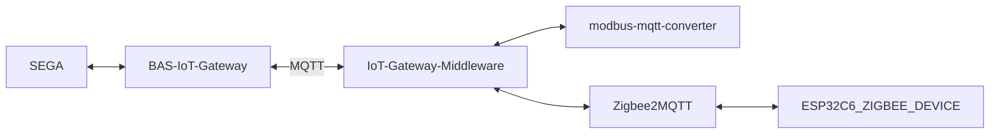

# SEGA HUB

Umbrella repository for the SEGA building energy & IoT platform.

## Architecture



**Dependency Flow:** `SEGA` → `BAS-IoT-Gateway` → `IoT-Gateway-Middleware` → `Modbus2MQTT` / `Zigbee2MQTT`

- **SEGA** — Main application for building monitoring, energy analytics, and maintenance.
- **BAS-IoT-Gateway** — Cloud gateway bridging SEGA and edge gateways via MQTT.
- **IoT-Gateway-Middleware** — Edge gateway consuming **Modbus2MQTT** (`modbus-mqtt-converter`) and **Zigbee2MQTT** (including **ESP32C6_ZIGBEE_DEVICE** nodes).

## Submodules

| Module | Repository | Role |
| --- | --- | --- |
| [`SEGA`](https://github.com/PT-Perkasa-Pilar-Utama/SEGA) | [PT-Perkasa-Pilar-Utama/SEGA](https://github.com/PT-Perkasa-Pilar-Utama/SEGA) | Web/Android app & API |
| [`BAS-IoT-Gateway`](https://github.com/PT-Perkasa-Pilar-Utama/BAS-IoT-Gateway) | [PT-Perkasa-Pilar-Utama/BAS-IoT-Gateway](https://github.com/PT-Perkasa-Pilar-Utama/BAS-IoT-Gateway) | Cloud IoT gateway |
| [`IoT-Gateway-Middleware`](https://github.com/PT-Perkasa-Pilar-Utama/IoT-Gateway-Middleware) | [PT-Perkasa-Pilar-Utama/IoT-Gateway-Middleware](https://github.com/PT-Perkasa-Pilar-Utama/IoT-Gateway-Middleware) | Edge gateway middleware |
| [`modbus-mqtt-converter`](https://github.com/PT-Perkasa-Pilar-Utama/modbus-mqtt-converter) | [PT-Perkasa-Pilar-Utama/modbus-mqtt-converter](https://github.com/PT-Perkasa-Pilar-Utama/modbus-mqtt-converter) | Modbus2MQTT engine (nested) |
| [`ESP32C6_ZIGBEE_DEVICE`](https://github.com/Muhammad-Yunus/ESP32C6_ZIGBEE_DEVICE) | [Muhammad-Yunus/ESP32C6_ZIGBEE_DEVICE](https://github.com/Muhammad-Yunus/ESP32C6_ZIGBEE_DEVICE) | ESP32-C6 Zigbee firmware (nested) |

## Quick Start

```bash
git clone --recurse-submodules git@github.com:PT-Perkasa-Pilar-Utama/SEGA-HUB.git
```

See each submodule's own `README.md` or `docs/` for setup details.
