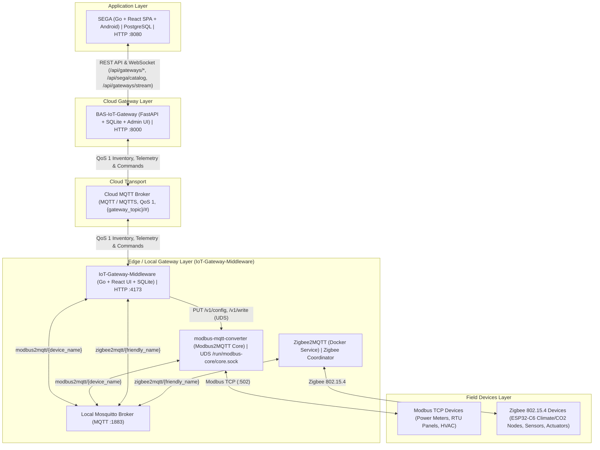

# SEGA HUB

Umbrella repository for the **SEGA** (*Smart Environment, Green and fresh Air*) building energy & IoT platform, organizing core services as Git submodules under `PT-Perkasa-Pilar-Utama`.

## High-Level Architecture



## Dependency Flow (`SEGA => BAS-IoT-Gateway => IoT-Gateway-Middleware`)

Each layer has a strict separation of concerns:

1. **`SEGA` (Application & Business Layer)**
   - Owns user accounts, buildings, rooms, equipment, energy analytics, preventive maintenance, and the end-user web/Android UI.
   - Depends on `BAS-IoT-Gateway` for synchronized gateway inventory, bound sensor telemetry, and device command execution.
2. **`BAS-IoT-Gateway` (Cloud IoT Gateway & Binding Layer)**
   - Aggregates multiple edge gateways via the Cloud MQTT Broker.
   - Reconciles gateway inventory snapshots, manages SEGA room/equipment bindings and location mappings, audits commands, and streams real-time updates to `SEGA` over REST & WebSocket (`/api/gateways/*`, `/api/sega/catalog`, `/api/gateways/stream`).
3. **`IoT-Gateway-Middleware` (Edge Gateway Layer)**
   - Runs at the building/site edge, organizes devices into a logical folder hierarchy, and normalizes cloud MQTT topics under `{gateway_topic}/{folder_path}/{device_slug}/{data|command}` plus `{gateway_topic}/_gateway/inventory/snapshot`.
   - Consumes two local protocol engines through the local Mosquitto broker (`:1883`) and sidecar orchestration:
     - **Modbus2MQTT (`modbus-mqtt-converter`)**: Headless Modbus TCP poller and MQTT bridge configured declaratively over Unix Domain Socket (`/run/modbus-core/core.sock`) and communicating via `modbus2mqtt/{device_name}`.
     - **Zigbee2MQTT**: Zigbee coordinator manager and MQTT bridge communicating via `zigbee2mqtt/{friendly_name}`.

## Data & Command Flows

- **Telemetry (Bottom-Up):**
  Field Devices → `modbus-mqtt-converter` / `Zigbee2MQTT` → Local Mosquitto → `IoT-Gateway-Middleware` (normalizes to `{gateway_topic}/.../data` and `_gateway/inventory/snapshot`) → Cloud MQTT Broker → `BAS-IoT-Gateway` (persists & maps to SEGA rooms/equipment) → `SEGA` (dashboards, analytics, alerts).
- **Commands (Top-Down):**
  `SEGA` → `BAS-IoT-Gateway` (`POST /api/gateways/commands`, audited) → Cloud MQTT Broker (`{gateway_topic}/.../command`, QoS 1) → `IoT-Gateway-Middleware` (validates writable capability & active route) → `modbus-mqtt-converter` / `Zigbee2MQTT` → Field Devices (telemetry feedback confirms execution).

## Submodules & Components

| Component | Repository / Source | Role | Stack / Port |
| --- | --- | --- | --- |
| [`SEGA`](SEGA/) | `PT-Perkasa-Pilar-Utama/SEGA` (`main`) | Core building energy & comfort platform | Go + React SPA + Android, PostgreSQL (`:8080`) |
| [`BAS-IoT-Gateway`](BAS-IoT-Gateway/) | `PT-Perkasa-Pilar-Utama/BAS-IoT-Gateway` (`main`) | Cloud gateway aggregator, bindings & command audit | Python FastAPI + SQLite (`:8000`) |
| [`IoT-Gateway-Middleware`](IoT-Gateway-Middleware/) | `PT-Perkasa-Pilar-Utama/IoT-Gateway-Middleware` (`main`) | Edge gateway UI, hierarchy & MQTT bridge | Go + React + SQLite + Docker Compose (`:4173`) |
| [`modbus-mqtt-converter`](IoT-Gateway-Middleware/modbus-mqtt-converter/) | `PT-Perkasa-Pilar-Utama/modbus-mqtt-converter` (nested submodule) | Headless Modbus2MQTT polling & discovery engine | Python FastAPI UDS sidecar (`/run/modbus-core/core.sock`) |
| `Zigbee2MQTT` | `ghcr.io/koenkk/zigbee2mqtt:2` (Docker service in `IoT-Gateway-Middleware`) | Zigbee pairing, interview & device control | Docker container + USB/TCP coordinator |

## Quick Start (Git Submodules)

Clone the hub along with all submodules (including the nested `modbus-mqtt-converter` submodule):

```bash
git clone --recurse-submodules git@github.com:PT-Perkasa-Pilar-Utama/SEGA-HUB.git
cd SEGA-HUB
```

If already cloned without submodules:

```bash
git submodule update --init --recursive
```

For service-specific environment variables, Docker setup, and run instructions, refer to each component's own `README.md` or `docs/` directory:

- [SEGA README](SEGA/README.md)
- [BAS-IoT-Gateway Docs](BAS-IoT-Gateway/docs/)
- [IoT-Gateway-Middleware README](IoT-Gateway-Middleware/README.md)
- [modbus-mqtt-converter README](IoT-Gateway-Middleware/modbus-mqtt-converter/README.md)
